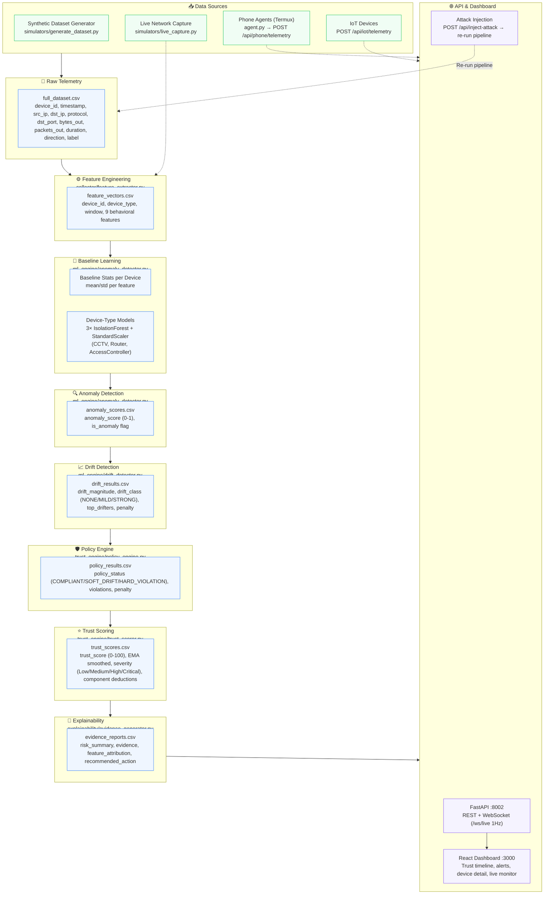

# IoT Trust & Drift Analytics Platform — Flow Diagram

## Visual Flow Diagram

Open **flow_diagram.html** in a browser for an interactive visual diagram, or view the Mermaid diagram below.

---

## Mermaid Diagram (Renderable in GitHub, Notion, Obsidian, etc.)



---

## Pipeline Stages Summary

| Stage | Module | Input | Output | Key Logic |
|-------|--------|-------|--------|-----------|
| **1** | Data Generation | — | `full_dataset.csv` | Synthetic IoT traffic (48h normal + 2h attacks) |
| **2** | Feature Engineering | `full_dataset.csv` | `feature_vectors.csv` | 9 behavioral features per device/hour |
| **3** | Baseline Learning | `feature_vectors.csv` (first 48h) | In-memory models + stats | Per-device baselines; 3× IsolationForest per device type |
| **4** | Anomaly Detection | Models + full features | `anomaly_scores.csv` | Score each window with matching device-type model |
| **5** | Drift Detection | Current features + baselines | `drift_results.csv` | Z-score per feature → mean magnitude → classify NONE/MILD/STRONG |
| **6** | Policy Evaluation | Raw flows + device profiles | `policy_results.csv` | 5 checks: protocol, port, dst IP, bandwidth, direction |
| **7** | Trust Scoring | Anomaly + Drift + Policy | `trust_scores.csv` | `100 - anomaly_ded - drift_ded - policy_ded` + EMA smoothing |
| **8** | Explainability | All pipeline outputs | `evidence_reports.csv` | Human-readable risk summary, evidence, action recommendation |
| **9** | API & Dashboard | CSV outputs | Live UI + REST API | FastAPI (port 8002) + React Dashboard (port 3000) |

---

## Data Flow: Column Lineage

```
full_dataset.csv
  │  device_id, timestamp, src_ip, dst_ip, protocol, dst_port, bytes_out, packets_out, duration, direction, label
  ▼
feature_vectors.csv                    (1-hour tumbling window aggregation)
  │  device_id, device_type, window, total_bytes_out, total_packets_out, avg_bytes_per_flow,
  │  num_flows, unique_dst_ips, unique_dst_ports, unique_protocols, external_ratio, avg_duration
  ▼
anomaly_scores.csv                     (IsolationForest per device-type)
  │  device_id, device_type, window, raw_score, anomaly_score (0-1), is_anomaly (0/1)
  ▼
drift_results.csv                      (Z-score vs baseline)
  │  device_id, window, drift_magnitude, drift_class, top_drifters, penalty
  ▼
policy_results.csv                     (Rule evaluation vs device_profiles.py)
  │  device_id, device_type, window, policy_status, violations, penalty
  ▼
trust_scores.csv                       (Merge + scoring formula + EMA)
  │  device_id, device_type, window, trust_score, trust_score_smoothed,
  │  severity, severity_smoothed, anomaly_deduction, drift_deduction, policy_deduction,
  │  anomaly_score, drift_class, policy_status
  ▼
evidence_reports.csv                   (Natural language explanations)
  │  device_id, device_type, window, trust_score_smoothed, severity_smoothed,
  │  risk_summary, evidence, feature_attribution, recommended_action,
  │  anomaly_score, drift_class, policy_status
```

---

## Key Architectural Decisions

1. **Device-Type Fingerprinting**: Separate IsolationForest + StandardScaler per device type (CCTV/Router/AccessController) — learns distinct behavioral baselines
2. **Three-Tier Detection**: ML Anomaly (unknown unknowns) + Statistical Drift (known unknowns) + Policy Rules (known knowns)
3. **EMA Smoothing**: α=0.3 prevents score flapping; reflects sustained behavior changes
4. **Explainability-First**: Every score deduction traced to specific evidence; generates analyst-ready reports
5. **Live Re-computation**: Attack injection triggers full pipeline re-run for immediate feedback
6. **Multi-Source Ingestion**: Synthetic, live PCAP, phone agents, and real IoT devices all feed same pipeline

---

## File Locations

- **Visual Diagram**: `flow_diagram.html` (open in browser)
- **Pipeline Runner**: `run_pipeline.py`
- **API Server**: `api/server.py` (port 8002)
- **Dashboard**: `dashboard/` (port 3000)
- **Output Data**: `data/*.csv`