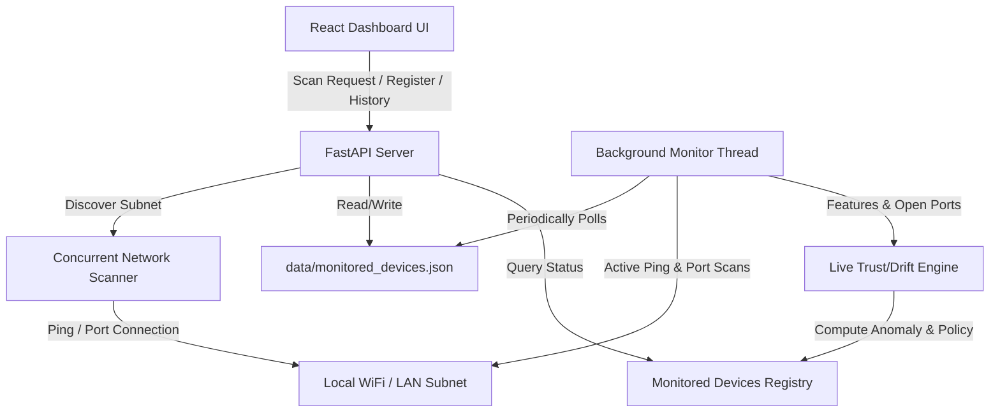

# Implementation Plan - Local IoT Device Network Monitoring

This plan outlines the changes required to implement a real network IoT device monitoring feature. It allows security analysts to scan their local subnet, discover active devices, register them for continuous background monitoring (pings, latency, packet loss, and port scans), and evaluate their security posture using the platform's core trust-scoring, anomaly-detection, and policy-evaluation engines.

## Proposed System Architecture

---

## Proposed Changes

### Backend Component

#### [NEW] [network_monitor.py](file:///home/shrek/Projects/iot-Trust_drift/iot-Trust_drift/api/network_monitor.py)
Create a new module `api/network_monitor.py` responsible for network discovery and background monitoring:
- **`NetworkIoTMonitor` Class**:
  - Manages the monitored devices list loaded/saved from `data/monitored_devices.json`.
  - Maintains `_monitored_status` (latest scored state) and `_history` (deque of historical metrics).
  - Starts a background thread scanning all registered devices every 8 seconds.
- **Concurrent Network Scanner**:
  - Automatically detects the host LAN/WiFi IP address and targets the local `/24` subnet.
  - Pings all 254 IP addresses in the subnet concurrently using `ThreadPoolExecutor` (50+ workers) for sub-second sweeps.
  - Queries active ARP entries from `/proc/net/arp` to obtain MAC addresses of discovered devices.
  - Performs banner/port connections on common IoT ports (`22`, `23`, `53`, `80`, `443`, `554` [RTSP], `1883` [MQTT], `8080`, `8443`) to fingerprint devices and estimate their device type (e.g. CCTV, Router, AccessController, Generic).
- **Ensemble Scorer Integration**:
  - Maps active network metrics (reachability, ping latency, packet loss, and open ports) into the project's behavioral feature vector.
  - If a device is responsive, it seeds normal baseline metrics for its assigned profile, modifying them relative to ping jitter/latency to trigger concept drift.
  - Maps open ports into virtual flows (e.g., port 22 open maps to an SSH flow).
  - Feeds features and flows into `LiveEngine._score_single_window()` to execute the **Isolation Forest model**, **Z-score drift detector**, and **Policy engine** inline.
  - Drops trust score to `0` and sets severity to `Critical` if a device goes offline.

#### [MODIFY] [server.py](file:///home/shrek/Projects/iot-Trust_drift/iot-Trust_drift/api/server.py)
Extend the FastAPI backend:
- Import `NetworkIoTMonitor` and initialize it on startup (passing `_live_engine`).
- Start the background monitoring loop in the lifespan startup hook.
- Implement the following REST endpoints:
  - `GET /api/network/discover`: Triggers an active subnet scan and returns a list of discovered devices.
  - `GET /api/network/monitored`: Returns all registered devices with their latest status, trust score, latency, and severity.
  - `POST /api/network/monitored/add`: Adds a device to the JSON registry.
  - `POST /api/network/monitored/delete`: Deletes a device from monitoring.
  - `GET /api/network/monitored/history`: Returns historical trust, latency, and packet loss metrics for graphing.

---

### Frontend Component

#### [NEW] [LocalNetworkMonitor.js](file:///home/shrek/Projects/iot-Trust_drift/iot-Trust_drift/dashboard/src/pages/LocalNetworkMonitor.js)
Create a new dashboard page utilizing recharts, axios, and modern CSS layout:
- **Scan & Discover UI**:
  - Banner displaying the detected local subnet with a "Scan Subnet" button.
  - Progress bar/indicator during active scans.
  - Scrollable grid/table of discovered devices showing: Hostname, IP, MAC address, open ports, and estimated type.
  - Quick "Add to Monitor" button that lets users assign custom names and profile templates.
- **Monitored Devices Grid**:
  - Glassmorphic card design displaying real-time metrics for each device:
    - Status badge: `Online` (green pulse) or `Offline` (red).
    - SVG trust score gauge with dynamic color coding (low, medium, high risk).
    - Severity tag mapping directly to SOC priority.
    - Statistics: Ping Latency (ms), Packet Loss (%), Open Ports (with alerts for profile policy violations).
- **Visual Analytics**:
  - Recharts timeline comparing Trust Scores and Ping Latencies for the monitored nodes over time.
- **Alert Feed & Policy Violations**:
  - List of rule violations (e.g., "Access Controller has unauthorized SSH port 22 open").

#### [MODIFY] [App.js](file:///home/shrek/Projects/iot-Trust_drift/iot-Trust_drift/dashboard/src/App.js)
Integrate the new page into the React app:
- Import `LocalNetworkMonitor` from `./pages/LocalNetworkMonitor`.
- Add a new route: `<Route path="/network-monitor" element={<LocalNetworkMonitor />} />`.
- Add a sidebar navigation item "Local Monitor" (using a network/radar icon) under the "Monitor" section.

---

## Verification Plan

### Automated Tests & Scripts
1. **Backend Integration Testing**:
   - Write a temporary test script `data/test_monitor.py` to trigger a discovery scan, register `127.0.0.1` as a monitored CCTV, and verify that the monitoring loop populates latency, packet loss, and trust score history.
   - Run the script: `python data/test_monitor.py`.

### Manual Verification
1. **Subnet Scan**:
   - Run the FastAPI server and trigger a subnet scan from the dashboard. Confirm that active hosts (like localhost and the WiFi gateway) are successfully discovered and mapped to their MAC addresses.
2. **Monitoring & Alerts**:
   - Add a device to be monitored.
   - Simulate a policy violation (e.g., open an unexpected port on a monitored host) and verify that the trust score drops and policy warnings display in the UI.
